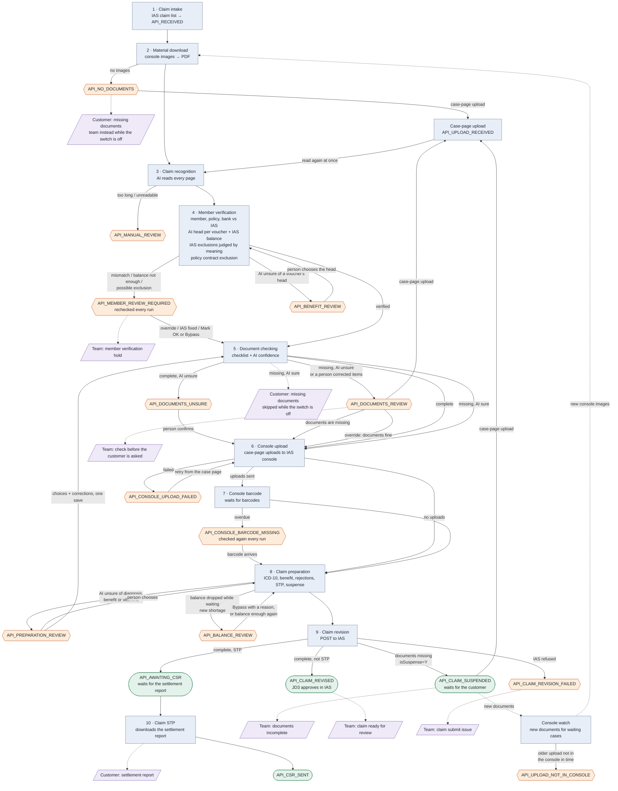

# API case flowchart

This chart shows how an API case moves from the IAS claim list to the IAS revision. It shows the pipeline jobs in order, the stops where a person decides, and the emails that go out. The source is `src/ulink-api/modules/pipeline/service.js` (`API_STEPS`) and the input and output statuses of each `api-*` job.

Last checked against the code: 2026-10-27. Published copy: https://claude.ai/artifact/6wQz6VycRj8e3TgdbvYWWg (private, republish it from this file after each change).

Image: [API_CASE_FLOWCHART.svg](API_CASE_FLOWCHART.svg). A Claude Code hook renders it from the chart below after each save of this file (`.claude/hooks/render-api-flowchart.sh`). If you edit the file outside Claude Code, run `.claude/hooks/render-api-flowchart.sh --all`.

When an API job, status, stop, switch or email changes, update this file in the same change. The checklist in `.claude/skills/ulink-pipeline-change/SKILL.md` (step 9) says the same.

## Flow

Blue boxes are pipeline jobs. Orange hexagons are stops that wait for a person. Green boxes are end or waiting states. Purple shapes are emails.

## Where a person decides

| Stop | Why the case waits | What the person can do | Switch |
|---|---|---|---|
| `API_NO_DOCUMENTS` | The IAS console has no images for the claim. | Upload on the case page, or wait. Console watch checks every run. | None |
| `API_MANUAL_REVIEW` | The documents are too long for the AI, or its answer did not match the claim schema. | Handle the claim by hand. | None |
| `API_BENEFIT_REVIEW` | The AI was not sure of a voucher's benefit head (switch `holdUnsureBenefit`). | Choose the head from the member's plan on the *Choose the benefit* panel, and correct a misread amount. The member check runs again and checks the balance. | None |
| `API_BALANCE_REVIEW` | The member balance dropped while the case waited for its documents: a voucher no longer fits. | Bypass with a reason (the only action). The revision is then prepared and never goes STP. Asked again every run: goes on by itself once the balance is enough. | None |
| `API_MEMBER_REVIEW_REQUIRED` | Member, policy or bank details differ from IAS, or the IAS balance is not enough for a voucher (`member:balance`), or the claim may fall under a member or policy exclusion in IAS (`member:exclusion`) or a policy contract clause (`member:contract_exclusion`). | Fix IAS (rechecked every run), Mark OK, correct a value, or override. A short balance or a possible exclusion in IAS: Bypass with a reason only, and the claim then never goes STP. A contract exclusion: *Does not apply* (STP stays possible) or *Let it go on* (never STP). | None |
| `API_DOCUMENTS_UNSURE` | The documents are complete, but the AI was unsure of an item. A reviewer's open request line also holds the case here, even when the switch is off. | Use the `Confirm and continue` button, or correct a value. | `holdUnsureDocumentPass` |
| `API_DOCUMENTS_REVIEW` | Documents are missing and the AI was unsure, or a person corrected items. | Documents are missing: continue (suspended revision). Documents are fine: override. Or correct a value. | `holdUnsureMissingDocsEmail` |
| `API_CONSOLE_UPLOAD_FAILED` | Case-page uploads did not reach the IAS console. | Retry from the case page. | None |
| `API_CONSOLE_BARCODE_MISSING` | Case-page uploads got no barcode in time. | Nothing to click: the barcode job checks again every run and continues when the barcode arrives. If it stays, look in the IAS console. | None |
| `API_UPLOAD_NOT_IN_CONSOLE` | Older cases only: an upload from the case page did not appear in the IAS console in time. | Look in the IAS console. Console watch keeps checking every run. | None |
| `API_PREPARATION_REVIEW` | The AI was unsure of the diagnosis code, a voucher's benefit, or its vitamins. | Choose. With corrections, one save sends both, and the case is checked again first. | `holdUnsureDiagnosis`, `holdUnsureBenefit`, `holdUnsureVitamin` |
| `API_CLAIM_REVISION_FAILED` | IAS refused the revision. | Retry from the case page. | None |

## Rules that are easy to miss

- A case-page upload is possible at `API_NO_DOCUMENTS`, `API_CLAIM_SUSPENDED`, `API_DOCUMENTS_REVIEW` and `API_DOCUMENTS_UNSURE`. The case goes to `API_UPLOAD_RECEIVED`, and the AI reads it again at once. Console upload then sends the files to the IAS console before the revision.
- An STP claim waits at `API_AWAITING_CSR` until IAS has the settlement report. Claim STP checks every run.
- Claim preparation decides STP, and STP never stops the revision. A never-STP diagnosis (ULINK's chronic list, R69), vitamins, an amount over the limit or an open review point sends the claim as non-STP. A check that can stop a case and was switched off does the same. JD3 then approves it in IAS.
- Missing documents never stop the revision. The revision goes with `isSuspense=Y`, and a suspended claim is never STP. The next revision with complete documents sends `isSuspense=N`, and IAS lifts the suspense.
- When `apiSendMissingDocumentsEmail` is on, the customer gets the missing-documents email (no images, or documents missing and the AI sure). When it is off, the customer gets no missing-documents email. ULINK emails the customer from the draft on the case page, and the team gets an email instead.
- A correction sends the case back to the document check. A correction of a value that the member check compares with IAS sends it back to the member check. A correction of the diagnosis or the treatment does the same. The claim preparation choices of a person stay for the next run.
- A super admin can switch a check off on *Admin → AI checklist* (with a reason). The member check and the document check skip it in both flows, and the case shows the line as *Turned off*, never a pass. A switched-off check adds no stop and sends no email. Five checks are locked on: member found, coverage active, bank details, member balance, voucher attached.
- When a job fails because IAS, the console or LM Studio does not answer, the case keeps its status. The next pipeline run tries again.
