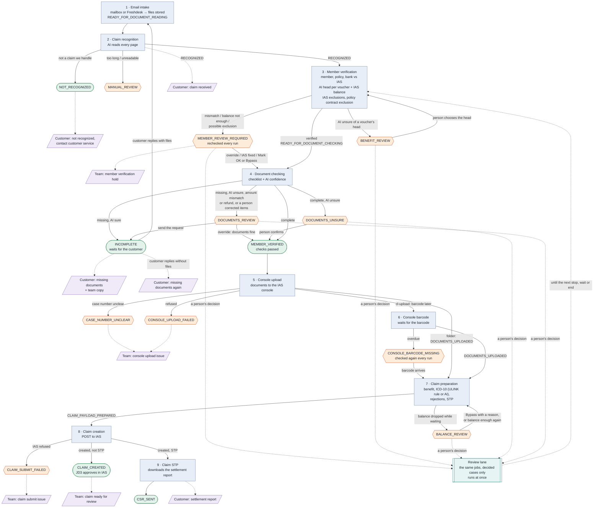

# Email case flowchart

This chart shows how an email case moves from a claim email in the mailbox to the IAS claim. It shows the pipeline jobs in order, the stops where a person decides, and the emails that go out. The source is `src/ulink-api/modules/pipeline/service.js` (`STEPS`) and the input and output statuses of each email job.

Last checked against the code: 2026-11-05. Published copy: https://claude.ai/artifact/7P9o1eg88DDG3vn28foN43 (private, republish it from this file after each change).

Image: [EMAIL_CASE_FLOWCHART.svg](EMAIL_CASE_FLOWCHART.svg). A Claude Code hook renders it from the chart below after each save of this file (`.claude/hooks/render-api-flowchart.sh`). If you edit the file outside Claude Code, run `.claude/hooks/render-api-flowchart.sh --all`.

When an email job, status, stop, switch or email changes, update this file in the same change. The checklist in `.claude/skills/ulink-pipeline-change/SKILL.md` (step 9) says the same.

## The flow in plain words

This part is for business users. The chart below has the detail.

1. A member emails a claim with the claim form, vouchers and medical documents. The system saves the email and its files.
2. The AI reads every page. If the email is not a claim that ULINK handles, the system tells the sender to contact customer service. If the AI cannot read the documents well, a person reads them.
3. The member gets an email that says the claim was received.
4. The system checks the member in IAS: the member, the policy, the coverage, the bank details and the balance. If something does not match, a person checks the case.
5. The system checks that every required document is there. If documents are missing, the member gets an email with the list. When the member replies with the documents, the case starts again from step 2.
6. The system uploads the documents to the IAS console.
7. The system prepares the claim and creates it in IAS.
8. A straight-through claim (STP) needs no person to approve it. For an STP claim, the system gets the settlement report from IAS and emails it to the member. Any other claim waits for a JD3 approver in IAS.

## Flow

Blue boxes are pipeline jobs. Orange hexagons are stops that wait for a person. Green boxes are end or waiting states. Purple shapes are emails.

## Where a person decides

| Stop | Why the case waits | What the person can do | Switch |
|------|--------------------|------------------------|--------|
| `MANUAL_REVIEW` | The documents are too long for the AI, or its answer did not match the claim schema. | Read the documents and handle the claim by hand. | None |
| `MEMBER_REVIEW_REQUIRED` | Member, coverage or bank details differ from IAS, the balance is not enough, or the claim can fall under an exclusion. | Fix in IAS (the case is checked again every run), Mark OK, correct a value, or override. A short balance or a possible exclusion: Bypass with a reason, and the claim then never goes STP. | None |
| `BENEFIT_REVIEW` | The AI was not sure of a voucher's benefit head. | Choose the head. The member check runs again with it. | `holdUnsureBenefit` |
| `DOCUMENTS_REVIEW` | Documents look incomplete, and the AI was unsure, or a person corrected items. If the voucher total differs from the claimed amount, or a voucher is below 0, the case always stops here. The customer was not emailed. | If the documents are missing, send the request to the customer. If the documents are fine, override. Or correct a value, for example each voucher amount. | `holdUnsureMissingDocsEmail` (not for the amount check) |
| `DOCUMENTS_UNSURE` | All documents passed, but the AI was unsure about some of them. | Use *Confirm and continue*, or ask for more information. | `holdUnsureDocumentPass` |
| `CASE_NUMBER_UNCLEAR` | The TPA case number on the claim form is not `AYA-CL-` and 8 digits. | Fix the form value, then reset the case. | None |
| `CONSOLE_UPLOAD_FAILED` | The console upload refused the documents. | Fix the cause, then use Try again on the case page. | None |
| `CONSOLE_BARCODE_MISSING` | The documents got no console barcode in time. | Nothing to click: the barcode job checks again every run. If it stays, look in the IAS console. | None |
| `BALANCE_REVIEW` | The member balance dropped while the case waited for its documents. | Bypass with a reason. The claim then never goes STP. The case goes on by itself once the balance is enough. | None |
| `CLAIM_SUBMIT_FAILED` | IAS refused the claim. | Read the reason in the team email and the case history, then fix and retry. | None |

## Rules that are easy to miss

- The email pipeline runs only while email cases are on (*System settings*, `emailCasesEnabled`). With it off, the email pipeline does not run, and new claim emails stay in the mailbox. Replies to API cases are then read by the API pipeline (see `API_CASE_FLOWCHART.md`).
- Some statuses wait for the customer: `INCOMPLETE`, `DOCUMENTS_REVIEW`, `MEMBER_REVIEW_REQUIRED`, `MANUAL_REVIEW` and the early statuses. At these statuses, a customer reply with files sends the case back to `READY_FOR_DOCUMENT_READING`. The AI then reads all documents again. A reply on a case that already went further is stored, but it does not restart the case.
- A customer reply without files at `INCOMPLETE` gets the missing documents list again, once for each reply.
- An email case stops at `INCOMPLETE` while documents are missing. The system creates the IAS claim after the documents are complete. An API case is different: its IAS claim already exists, and missing documents do not stop it.
- Only the AYAS member claim route (`ayas_member_claim`) goes on to the console upload and IAS.
- The console upload uses one of two methods (`CONSOLE_UPLOAD_METHOD`). The folder method makes the barcode at once. The cl-upload method waits for the console to make it, about every 15 minutes.
- Claim preparation decides STP. A never-STP diagnosis, vitamins, an amount over the limit or an open review point makes the claim non-STP. JD3 then approves it in IAS.
- If the claim form text gives no diagnosis code (R69), or only "unwell" (R53), claim preparation tries the doctor's note text. A sure code from the note can go STP when every other condition is met. The AI summary and the STP line say that it came from the note.
- A person's decision at a stop marks the case. The email review lane then runs the same jobs at once, on marked cases only.
- When a job fails because IAS, the console or LM Studio does not answer, the case keeps its status. The next pipeline run tries again.
